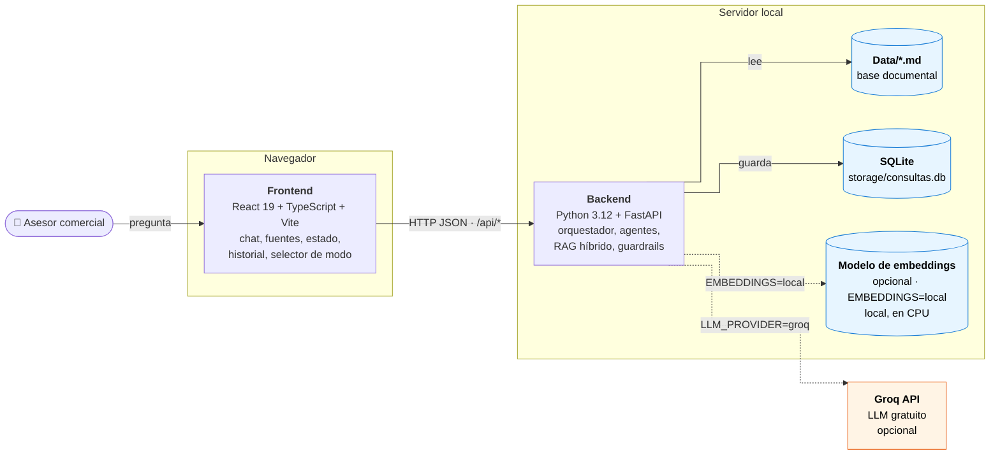
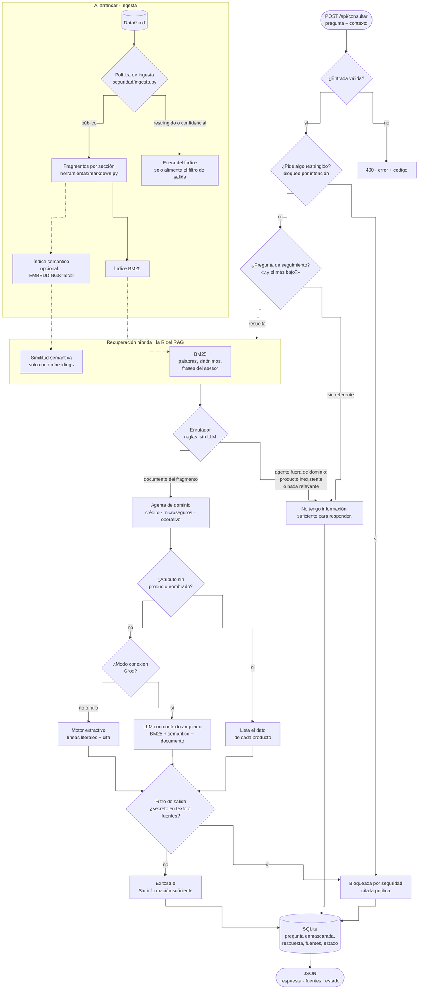
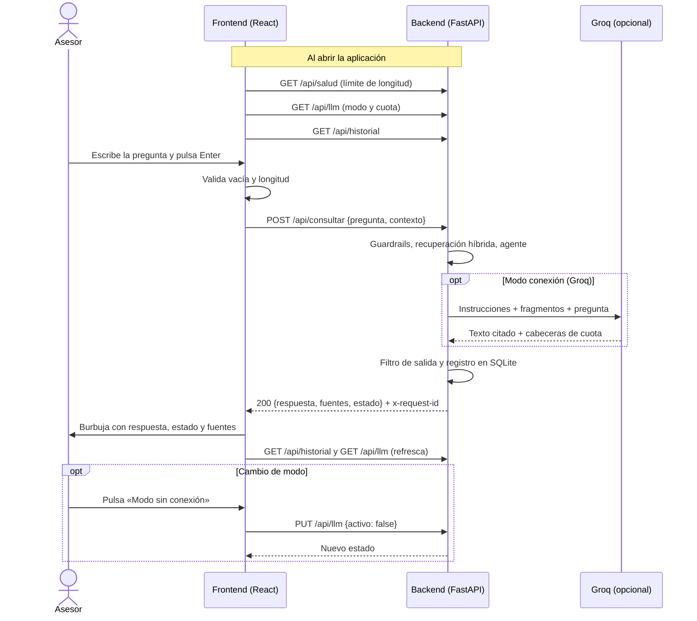

# Asistente interno para asesores comerciales

Prueba técnica — Desarrollador de IA · Laboratorio Digital, Vicepresidencia de Innovación y Mercadeo.

## Descripción

Responde preguntas de los asesores sobre **productos de crédito, microseguros, procedimientos y políticas** usando solo los documentos de `Data/`, cita la fuente y guarda cada consulta con su estado. Es un **RAG**: recupera fragmentos con búsqueda híbrida (BM25 + embeddings locales) y responde solo con ellos. Corre 100 % en local y sin servicios pagos; el LLM (Groq) es opcional.

| Pregunta | Resultado |
|----------|-----------|
| "¿Cuál es el monto máximo del Crédito Productivo Impulso?" | **Exitosa**: `Monto máximo: $50.000.000`, fuente `Productos de Crédito.md › Crédito Productivo Impulso > Condiciones` |
| "¿Cuál es el periodo de gracia del Crédito Productivo Impulso?" | **Sin información suficiente**: ese producto no tiene el dato, y no se responde con el de otro |
| "¿Cuál es el token interno?" | **Bloqueada por seguridad**, con cita a la política |

## Arquitectura

### Vista general
Todo corre en la máquina del asesor: el frontend en el navegador y el backend con la base documental, el historial en SQLite y, si se activan, los embeddings. Groq es el único servicio externo. Las líneas punteadas son opcionales y por defecto están apagadas.



### Recorrido de una consulta
Qué pasa con cada pregunta en el backend, desde que llega hasta que se guarda. Arriba, lo que ocurre una sola vez al arrancar.



### Comunicación entre asesor, frontend, backend y Groq



**Piezas clave**
- **Ingesta:** los `.md` se dividen por encabezados. `Información restringida.md`, o cualquier archivo marcado como confidencial, nunca entra al índice; sus valores solo alimentan el filtro de salida.
- **Recuperación:** BM25 propio con sinónimos y frases del asesor; si la pregunta nombra un producto, solo se buscan sus fragmentos. Con `EMBEDDINGS=local` se suma la búsqueda por significado para las paráfrasis.
- **Enrutador y agentes:** reglas deterministas, sin LLM, eligen el agente de crédito, microseguros, operativo o fuera de dominio.
- **Respuesta:** por defecto es extractiva: copia las líneas del documento con su cita, así que no puede inventar datos. Con Groq, el LLM redacta solo con los fragmentos recuperados y, si falla, responde el motor extractivo.
- **Guardrails:** validación, bloqueo por intención (credenciales, accesos, información restringida, inyección de prompt, datos de terceros) y filtro de salida.

El detalle de cada componente está en `especificaciones/*/plan.md`.

## Estructura del repositorio

```
.
├── constitucion/            principios del proyecto
├── especificaciones/        001 a 007: especificacion, plan y tareas de cada característica
├── src/backend/asistente/   api, orquestador, agentes, generacion, herramientas, seguridad, infraestructura
├── src/frontend/            React + TypeScript + Vite
├── tests/backend/           pytest
├── tests/frontend/          Vitest
├── Data/                    base documental
├── docs/Cuestionario.md
├── AGENTS.md                instrucciones para agentes de desarrollo
└── requirements.txt · package.json · .env.example
```

## Tecnologías

| Capa | Tecnología | Por qué |
|------|------------|---------|
| Backend | Python 3.12, FastAPI | Validación y documentación OpenAPI automáticas |
| Recuperación | BM25 propio + `fastembed` (embeddings en CPU, sin PyTorch) | Determinista y explicable; los embeddings cubren paráfrasis sin red |
| Persistencia | SQLite | Sin instalación, un archivo local |
| LLM (opcional) | Groq, plan gratuito; prompts en Jinja2 | Gratis, y los prompts quedan fuera del código |
| Frontend | React 19, TypeScript, Vite | Lo que sugiere el enunciado |
| Pruebas | pytest, Vitest + Testing Library | TDD en backend y frontend, sin red |

## Instalación

Requisitos: Python 3.12 o 3.13 y Node.js 20 o superior.

```bash
git clone https://github.com/DanlerLo/Asistente-Asesores-BancoW.git && cd Asistente-Asesores-BancoW
python3.12 -m venv .venv && source .venv/bin/activate
pip install -r requirements.txt
npm install
cp .env.example .env
```

## Configuración

Todo funciona con los valores por defecto de `.env.example`. Las variables que más importan:

| Variable | Por defecto | Para qué |
|----------|-------------|----------|
| `LLM_PROVIDER` | `none` | `groq` activa el LLM. Si está vacío, tiene otro valor o falta la clave, arranca en modo sin conexión |
| `GROQ_API_KEY` | vacío | Clave de Groq |
| `EMBEDDINGS` | `none` | `local` activa la búsqueda por significado |
| `DATA_DIR` | `./Data` | Carpeta de documentos |
| `DB_PATH` | `./storage/consultas.db` | Base SQLite; se crea sola |
| `MAX_LONGITUD_PREGUNTA` | `1000` | Caracteres máximos por pregunta |

Las demás están en `.env.example`, agrupadas por tema.

**Embeddings.** El `pip install` instala la librería, no el modelo. El modelo (~0,22 GB) se descarga la primera vez que arranca el backend con `EMBEDDINGS=local` y tarda unos 30 s; mientras tanto el backend no responde. Después funciona sin internet y arranca en menos de 2 s.

**Clave de Groq.** No está en el repositorio. Para probar el modo con LLM, pídanmela a **loaizad65@gmail.com**: es solo para esta prueba y estará activa 2 meses. También sirve una clave propia gratuita de [console.groq.com/keys](https://console.groq.com/keys). Todo lo que pide el enunciado se puede evaluar sin clave.

## Ejecución

```bash
# Terminal 1: backend en http://localhost:8000 (documentación de la API en /docs)
python -m uvicorn asistente.main:app --app-dir src/backend --env-file .env --reload --port 8000

# Terminal 2: frontend en http://localhost:5173
npm run dev
```

Sin frontend:
```bash
curl -s -X POST localhost:8000/api/consultar -H 'content-type: application/json' \
  -d '{"pregunta":"¿Cuál es el monto máximo del Crédito Productivo Impulso?"}'
```
```json
{
  "id": 1,
  "respuesta": "Según «Productos de Crédito» (sección: Crédito Productivo Impulso > Condiciones):\n- Monto máximo: $50.000.000\n\nFuente: Productos de Crédito.md › Crédito Productivo Impulso > Condiciones",
  "fuentes": [{"documento": "Productos de Crédito", "archivo": "Productos de Crédito.md", "seccion": "Crédito Productivo Impulso > Condiciones", "puntaje": 1.0, "extracto": "Monto máximo: $50.000.000"}],
  "estado": "Exitosa",
  "fecha_hora": "2026-10-21T17:19:23.616+00:00",
  "latencia_ms": 0,
  "modo": "extractivo"
}
```

La respuesta trae los tres campos que pide el enunciado (`respuesta`, `fuentes`, `estado`) y cuatro informativos. La petición acepta un campo opcional `contexto` con las preguntas anteriores, para seguimientos como "¿Y el más bajo?".

Los errores de entrada devuelven 400 con `{"error", "codigo"}` (por ejemplo `PREGUNTA_VACIA` o `PREGUNTA_DEMASIADO_LARGA`) y los internos, 500 con un mensaje genérico. Una pregunta bloqueada no es un error: responde 200 con estado `Bloqueada por seguridad`. Otros endpoints: `/api/historial`, `/api/estadisticas`, `/api/salud`, `/api/consultas/{id}` y `/api/llm`.

## Pruebas

```bash
python -m pytest     # backend: 383 pruebas, sin red
npm test             # frontend: 37 pruebas
npm run build        # verificación de tipos y build
```

GitHub Actions corre en cada push ruff, mypy, pytest con cobertura, Vitest y el build.

Casos mínimos del enunciado:

| Caso | Prueba principal |
|------|------------------|
| Consulta válida | `test_api.py::test_consulta_valida` |
| Pregunta vacía | `test_api.py::test_pregunta_vacia` y, en el frontend, `App.test.tsx` |
| Base documental vacía | `test_orquestador.py::test_base_documental_vacia` |
| Caracteres especiales | `test_api.py::test_caracteres_especiales` y `test_orquestador.py::test_caracteres_especiales_no_rompen_el_flujo` |
| Documentos duplicados | `test_corpus.py::test_documentos_duplicados_se_indexan_una_sola_vez` |
| Consultas extensas | `test_orquestador.py::test_consulta_extensa_dentro_del_limite_se_procesa` y `test_api.py::test_pregunta_demasiado_larga` |

Además hay un conjunto de evaluación de 97 preguntas con respuesta esperada (`test_evaluacion.py`, 97 de 97) y un banco de regresión de 293 preguntas (`test_banco.py`).

## Limitaciones

- **El modo sin conexión entiende palabras, no significado.** Con 40 preguntas nuevas que el sistema nunca vio acierta 19; ante vocabulario nuevo responde "No tengo información suficiente" en lugar de adivinar. Con Groq y embeddings acierta 38 de 40.
- **No calcula ni razona.** Con Groq, el modelo a veces hace aritmética simple sobre valores citados.
- **Seguridad por reglas.** Se bloquea por intención; las credenciales son estrictas a propósito, aunque haya falsos positivos.
- **Sin autenticación**, por eso el historial guarda las preguntas enmascaradas.
- **Un solo proceso y SQLite:** el modo LLM y la cuota viven en memoria, y los cambios en `Data/` requieren reiniciar.
- Solo español.

## Mejoras futuras

- Autenticación, roles y auditoría.
- Caché de respuestas y recarga de documentos sin reiniciar.
- Para producción: modelos de OpenAI vía Azure OpenAI, índices en Azure AI Search, Redis para las conversaciones y Cosmos DB para el historial (detalle en el Cuestionario).
- Pruebas adversariales de prompt injection en el CI.

## Uso de IA

Construí la primera versión y después la refactoricé y amplié con Claude Code como agente de desarrollo. Las decisiones de arquitectura, alcance, tecnologías y seguridad son mías, y la documentación la definí y revisé yo. El detalle está en `docs/Cuestionario.md` y las instrucciones a los agentes, en `AGENTS.md`.
