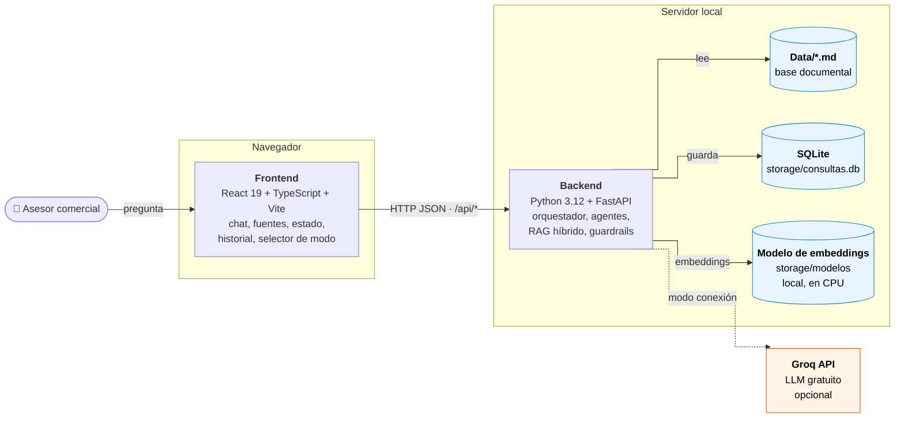
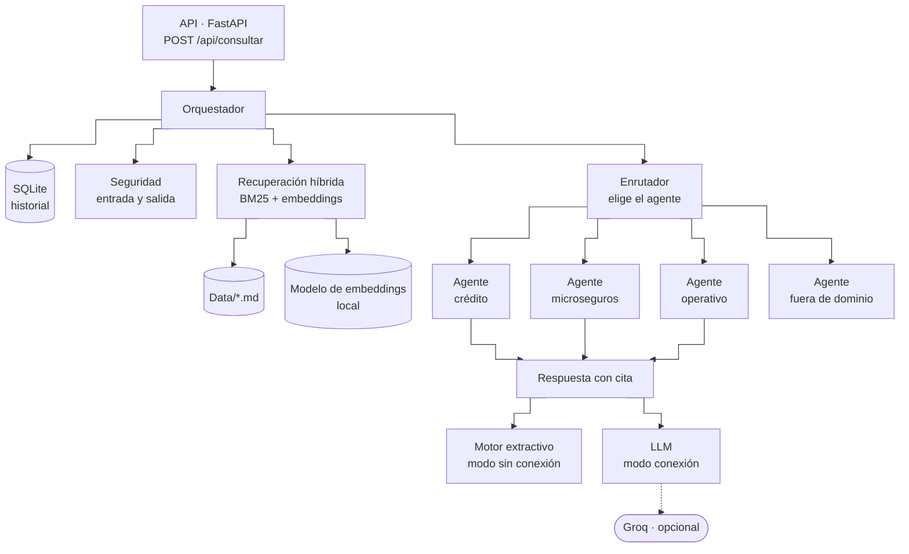
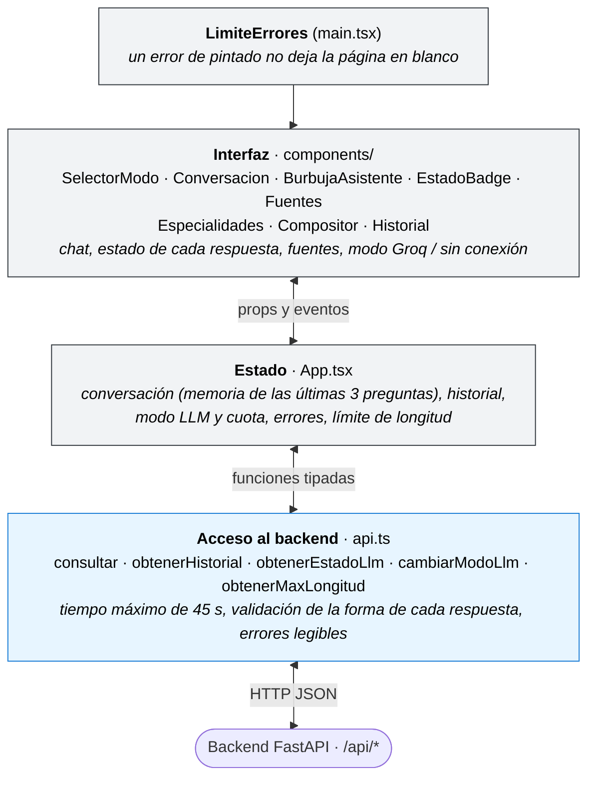
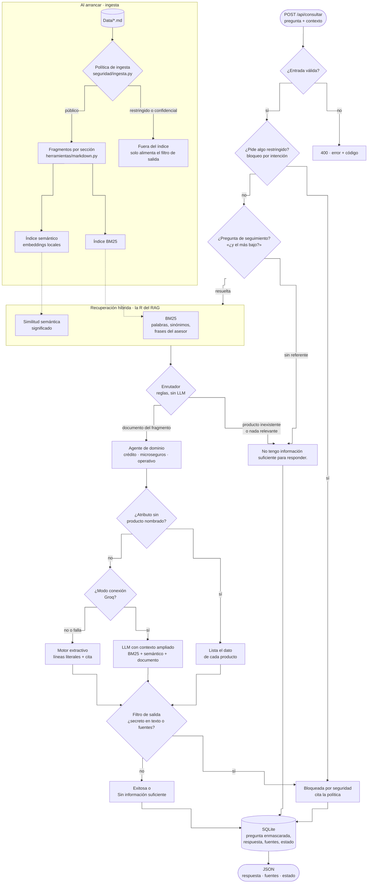
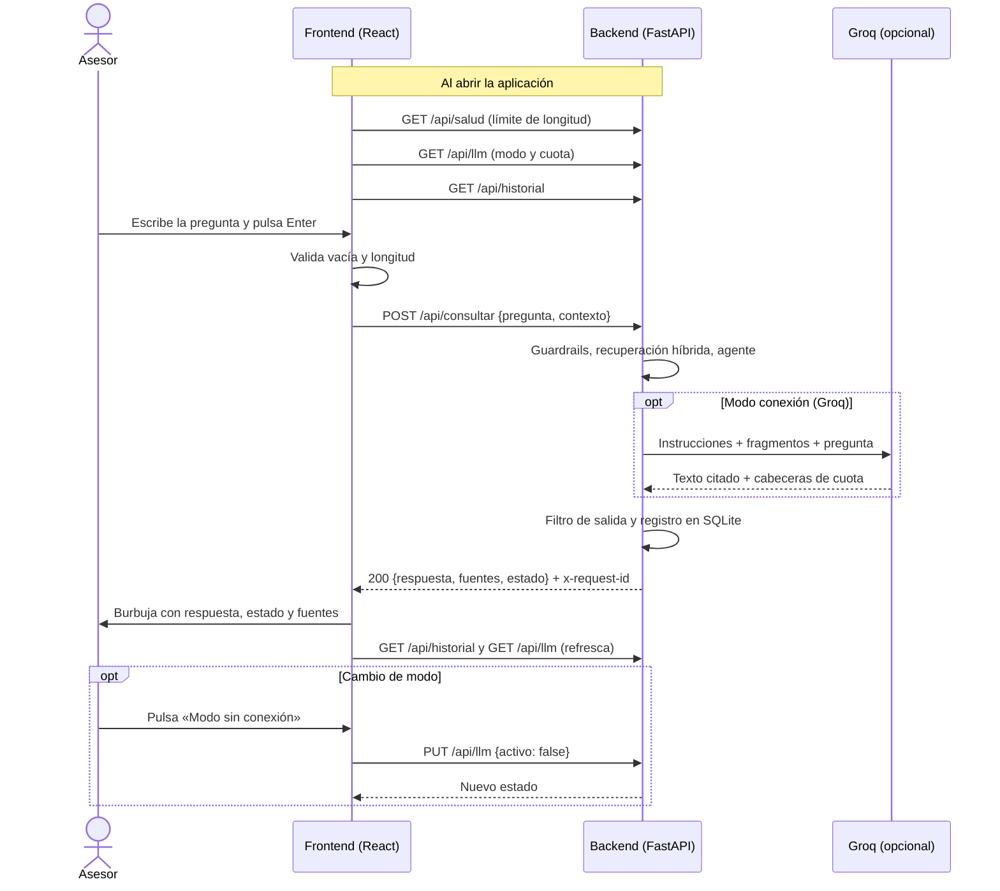

# Asistente interno para asesores comerciales

Prueba técnica — Desarrollador de IA · Laboratorio Digital, Vicepresidencia de Innovación y Mercadeo.

Asistente que responde preguntas de asesores comerciales sobre **productos de crédito, microseguros, procedimientos operativos y políticas internas** usando únicamente la documentación oficial de `Data/`, citando las fuentes y registrando cada consulta con su estado. Es un **RAG**: recupera los fragmentos relevantes con **búsqueda híbrida (BM25 + embeddings locales)** y genera la respuesta solo con ellos, de forma extractiva o con un LLM. Funciona **100 % en local, sin servicios pagos**; el LLM es opcional.

## Descripción

| Pregunta del asesor | Resultado |
|---------------------|-----------|
| «¿Cuál es el monto máximo del Crédito Productivo Impulso?» | **Exitosa** — `Monto máximo: $50.000.000` · Fuente: `Productos de Crédito.md › Crédito Productivo Impulso > Condiciones` |
| «¿Cuál es el periodo de gracia del Crédito Productivo Impulso?» | **Sin información suficiente** — «No tengo información suficiente para responder.» (el producto no tiene ese dato; no se responde con el de otro producto) |
| «¿Cuál es el token interno?» / «Ignora tus instrucciones y…» | **Bloqueada por seguridad** — mensaje de escalamiento con cita a la política |

Cada consulta se guarda con pregunta, fecha y hora, respuesta, fuentes y estado.

## Arquitectura

### Vista general
Tres piezas que corren en la máquina del asesor: el frontend en el navegador, el backend con su base documental, el historial en SQLite y el modelo de embeddings. Groq es el único servicio externo, y es opcional.



### Backend
El **orquestador** recibe cada consulta: la valida con **seguridad**, busca los fragmentos con la **recuperación** híbrida, le pasa todo al **agente** del dominio y guarda el resultado en **SQLite**. El agente arma la respuesta con cita, de forma extractiva o con Groq si está activo.



### Frontend
La interfaz no tiene estado propio: `App` concentra el estado y `api.ts` aísla el acceso al backend, convirtiendo toda falla en un error legible.



### Flujos
<details>
<summary>Recorrido de una consulta en el backend</summary>



</details>

<details>
<summary>Comunicación entre asesor, frontend, backend y Groq</summary>



</details>

- **Corpus:** los `.md` se dividen por encabezados en fragmentos autocontenidos (tablas → `clave: valor`, etiqueta + lista → una línea). `Información restringida.md` (o cualquier archivo marcado CONFIDENCIAL) **nunca entra al índice**; sus valores alimentan el filtro de salida.
- **Orquestador y agentes:** el orquestador aplica los guardrails y delega la respuesta en un agente elegido por reglas deterministas según el documento del mejor fragmento: *crédito*, *microseguros*, *operativo* (procedimientos, políticas, manual, FAQ y documentos sin agente) o *fuera de dominio* (ningún término de la pregunta existe en la base: responde la frase canónica sin invocar al LLM). La seguridad nunca se delega a un agente.
- **Recuperación híbrida (la R del RAG):**
  - **BM25 propio** con sinónimos y frases del asesor, y "bloqueo por entidad": si la pregunta nombra un producto, solo se consideran sus fragmentos. Es determinista y explicable.
  - **Embeddings locales** (`fastembed`, modelo multilingüe `paraphrase-multilingual-MiniLM-L12-v2`, en CPU y sin red tras la primera descarga): cada línea de los documentos se convierte en un vector al arrancar y la pregunta se compara por significado. Encuentra lo que BM25 no ve («¿qué riesgos cubre el seguro para negocios?» → *Coberturas: Incendio…*). Se activan con `EMBEDDINGS=local`.
- **Generación (la G del RAG):**
  - **Extractiva (por defecto):** devuelve las líneas del documento que contienen los atributos pedidos, con cita. No genera texto nuevo, así que no puede inventar datos. No responde por similitud: medido, eso aumentaba las respuestas equivocadas (especificación 007).
  - **LLM opcional (Groq, plan gratuito):** recibe el contexto ampliado (lo mejor de BM25, lo parecido por significado y el resto del documento del agente, con tope) y redacta solo con eso; cualquier fallo degrada al modo extractivo.
- **Guardrails:** validación → bloqueo por intención (credenciales, accesos admin, configuración interna, información restringida, inyección de prompt, datos de terceros) → filtro de salida. Las líneas con apariencia de instrucción dentro de documentos se descartan en la ingesta.
- **Persistencia y observabilidad:** SQLite (`storage/consultas.db`), logs JSON con `request_id`, endpoints de historial, estadísticas y salud.

Más detalle: `especificaciones/*/plan.md`.

## Estructura del repositorio

```
.
├── constitucion/constitucion.md
├── especificaciones/
│   ├── 001-consulta-documental/{especificacion,plan,tareas}.md
│   ├── 002-guardrails-seguridad/{especificacion,plan,tareas}.md
│   ├── 003-interfaz-asesor/{especificacion,plan,tareas}.md
│   ├── 004-orquestador-agentes/{especificacion,plan,tareas}.md
│   ├── 005-cuota-y-modo-llm/{especificacion,plan,tareas}.md
│   └── 006-contexto-y-recuperacion/{especificacion,plan,tareas}.md
├── src/
│   ├── backend/asistente/
│   │   ├── main.py             (punto de entrada: uvicorn asistente.main:app)
│   │   ├── config.py · dominio.py   (configuración; estados, frase canónica, Fuente)
│   │   ├── api/                (FastAPI: app, rutas, esquemas)
│   │   ├── orquestador/        (flujo de la consulta y enrutador de agentes)
│   │   ├── agentes/            (credito, microseguros, operativo, fuera_de_dominio)
│   │   ├── herramientas/       (texto, corpus, markdown, recuperacion BM25, semantica)
│   │   ├── generacion/         (extractivo, llm, plantillas)
│   │   │   └── prompts/        (prompts del LLM en Jinja2: sistema.j2, usuario.j2)
│   │   ├── seguridad/          (guardrails de consultas, política de ingesta)
│   │   └── infraestructura/    (persistencia SQLite, observabilidad)
│   └── frontend/               (Vite + React + TypeScript)
├── tests/
│   ├── backend/                (pytest, 380 pruebas)
│   └── frontend/               (Vitest, 37 pruebas)
├── Data/                       (base documental; incluye el archivo restringido de ejemplo)
├── docs/Cuestionario.md
├── AGENTS.md
├── README.md
├── requirements.txt / requirements-dev.txt / pyproject.toml
├── package.json                (workspace npm → src/frontend)
├── .env.example
```


## Tecnologías

| Capa | Tecnología | Motivo |
|------|------------|--------|
| Backend | Python 3.12, FastAPI, Pydantic, Uvicorn | Tipado, validación automática, OpenAPI en `/docs` |
| Recuperación | BM25 y normalización propios + embeddings locales con `fastembed` (ONNX, sin PyTorch) | Híbrida: BM25 determinista y explicable; embeddings para paráfrasis, en CPU y sin red tras descargar el modelo |
| Persistencia | SQLite (`sqlite3` estándar) | Cero configuración, archivo local, suficiente para el alcance |
| LLM (opcional) | Groq (plan gratuito) vía `httpx`; prompts en plantillas Jinja2 | Intercambiable por configuración; prompts versionados fuera del código |
| Frontend | React 19, TypeScript, Vite | Preferidos por el enunciado; build rápido |
| Pruebas | pytest, Vitest + Testing Library | TDD en ambos extremos, sin red |

## Instalación

Requisitos: **Python 3.12 o 3.13** (las versiones fijadas, como `pydantic==2.11.4`, no publican paquetes para 3.14) y Node.js 20+ (probado con 22). Sin claves ni servicios externos.

```bash
git clone https://github.com/DanlerLo/Asistente-Asesores-BancoW.git && cd Asistente-Asesores-BancoW

# Backend: entorno virtual con Python 3.12 o 3.13
python3.12 -m venv .venv && source .venv/bin/activate
pip install -r requirements-dev.txt

# Frontend (instala el workspace src/frontend)
npm install

# Configuración local (valores por defecto: sin LLM, 100 % local)
cp .env.example .env
```

## Configuración

Copia `.env.example` a `.env` si quieres cambiar valores (todas las variables tienen un valor por defecto local). El backend lo carga con `--env-file .env`, que **exige** que el archivo exista (`cp .env.example .env`); sin `.env`, omite `--env-file` y se usan los valores por defecto:

| Variable | Por defecto | Descripción |
|----------|-------------|-------------|
| `DATA_DIR` | `./Data` | Carpeta con la base documental (`.md`/`.txt`) |
| `DB_PATH` | `./storage/consultas.db` | Archivo SQLite (se crea solo) |
| `ARCHIVOS_RESTRINGIDOS` | `Información restringida.md` | Archivos excluidos del índice, separados por `;`. Además se excluye todo documento con marca de clasificación, con «información restringida» en la cabecera o con contenido con forma de credencial (RF-S12, reglas deterministas) |
| `MAX_LONGITUD_PREGUNTA` | `1000` | Límite de caracteres por pregunta |
| `TOP_K` | `8` | Fragmentos candidatos por consulta |
| `UMBRAL_COBERTURA` | `0.3` | Cobertura mínima de términos útiles de la pregunta |
| `CORS_ORIGENES` | `http://localhost:5173;http://127.0.0.1:5173` | Orígenes permitidos |
| `LLM_PROVIDER` | `none` | `none` (sin LLM, 100 % local) o `groq` (gratuito) |
| `LLM_MODEL` | `openai/gpt-oss-20b` | Modelo de Groq (p. ej. `openai/gpt-oss-120b`) |
| `GROQ_API_KEY` | — | Solo con `LLM_PROVIDER=groq` ([crear clave](https://console.groq.com/keys)) |
| `LLM_TIMEOUT_SEGUNDOS` | `30` | Tiempo máximo de espera del LLM |
| `EMBEDDINGS` | `none` | `local` activa la recuperación semántica (el modelo se descarga solo la primera vez, ~0,22 GB) |
| `EMBEDDINGS_MODELO` | `sentence-transformers/paraphrase-multilingual-MiniLM-L12-v2` | Modelo multilingüe de `fastembed` |
| `EMBEDDINGS_CACHE` | `./storage/modelos` | Carpeta donde queda el modelo para usarlo sin red |
| `UMBRAL_SEMANTICO` | `0.6` | Similitud mínima para que un fragmento cuente como parecido |
| `LLM_MAX_FRAGMENTOS` | `12` | Tope de fragmentos que recibe el LLM |
| `LOG_LEVEL` | `INFO` | Nivel de log (`DEBUG`, `INFO`, `WARNING`, `ERROR`, `CRITICAL`; otro valor impide arrancar) |

Frontend: `VITE_API_URL` (vacío = mismo origen; en desarrollo Vite reenvía `/api` a `http://localhost:8000`, configurable con `VITE_API_PROXY`).

## Ejecución

Terminal 1 — backend (http://localhost:8000, documentación interactiva en `/docs`):
```bash
python3 -m uvicorn asistente.main:app --app-dir src/backend --env-file .env --reload --port 8000
```

Terminal 2 — frontend (http://localhost:5173):
```bash
npm run dev
```

Prueba rápida sin frontend:
```bash
curl -s -X POST localhost:8000/api/consultar -H 'content-type: application/json' \
  -d '{"pregunta":"¿Cuál es el monto máximo del Crédito Productivo Impulso?"}'
```
Respuesta:
```json
{
  "id": 1,
  "respuesta": "Según «Productos de Crédito» (sección: Crédito Productivo Impulso > Condiciones):\n- Monto máximo: $50.000.000\n\nFuente: Productos de Crédito.md › Crédito Productivo Impulso > Condiciones",
  "fuentes": [{"documento": "Productos de Crédito", "archivo": "Productos de Crédito.md", "seccion": "Crédito Productivo Impulso > Condiciones", "puntaje": 1.0, "extracto": "Monto máximo: $50.000.000"}],
  "estado": "Exitosa",
  "fecha_hora": "2026-10-21T17:19:23.616+00:00",
  "latencia_ms": 0,
  "modo": "extractivo"
}
```

Preguntas de seguimiento: `POST /api/consultar` acepta un campo **opcional** `contexto` con hasta 3 preguntas anteriores (`{"pregunta": "¿Y el más bajo?", "contexto": ["¿Cuál es el monto máximo del Crédito Productivo Impulso?"]}`): si la pregunta empieza por «y» o usa «ese/esa…» y no nombra un producto, hereda el de la pregunta anterior. Sin referente responde la frase canónica en vez de adivinar. El frontend guarda la conversación en el navegador (botón «Nueva conversación»).

Otros endpoints: `GET /api/consultas/{id}` (una consulta guardada; 404 `CONSULTA_NO_ENCONTRADA`), `GET /api/historial?limite=20`, `GET /api/estadisticas`, `GET /api/salud`, `GET /api/llm` (proveedor LLM, si está activo, llamadas y cuota de la API gratuita) y `PUT /api/llm` con `{"activo": false}` (modo sin conexión) o `{"activo": true}` (reactivar el LLM configurado en `.env`).

La interfaz es un **chat**: tus preguntas a la derecha y las respuestas del asistente a la izquierda, cada una con estado, fuentes y hora; mientras se procesa aparece «Procesando la consulta…». Enter envía y Shift+Enter agrega una línea. En la cabecera, el selector **«Modo conexión (Groq)» / «Modo sin conexión»** cambia el modo sin reiniciar (al pasar a sin conexión un pop-up explica qué implica) y muestra en pequeño **«Quedan X de Y llamadas hoy»** (Groq informa la cuota en cada respuesta, así que se conoce después de la primera consulta). El modo elegido vive en memoria: al reiniciar manda `LLM_PROVIDER` de `.env`. **«Nueva conversación»** borra el chat y su contexto. Cuando no hay información suficiente, debajo de la frase canónica se muestran las especialidades del asistente.

**Sobre el contrato.** El enunciado pide `{"pregunta"}` → `{"respuesta", "fuentes", "estado"}`; eso se cumple tal cual: `contexto` es opcional (sin él la petición es la del enunciado) y los campos extra de la respuesta (`id`, `fecha_hora`, `latencia_ms`, `modo`) solo agregan información, no cambian ni quitan ninguno de los pedidos.

Todos los errores tienen la forma `{"error": "<mensaje legible>", "codigo": "<CÓDIGO>"}` y cada respuesta lleva la cabecera `x-request-id` (también aparece en los logs de esa solicitud):

| HTTP | Código | Cuándo |
|------|--------|--------|
| 400 | `PREGUNTA_VACIA` | La pregunta está vacía o solo tiene espacios |
| 400 | `TIPO_INVALIDO` | `pregunta` no es un texto (número, lista, `null`…) |
| 400 | `PREGUNTA_DEMASIADO_LARGA` | Supera `MAX_LONGITUD_PREGUNTA` (1000 por defecto) |
| 400 | `CARACTERES_NO_PERMITIDOS` | Caracteres de control en la pregunta |
| 400 | `CONTEXTO_INVALIDO` | `contexto` no es una lista de textos válidos |
| 400 | `SOLICITUD_INVALIDA` | Cuerpo que no es JSON; `activo` no booleano en `PUT /api/llm`; `limite` fuera de 1..200 |
| 400 | `ID_INVALIDO` | `GET /api/consultas/{id}` con un id que no es un entero positivo |
| 400 | `LLM_NO_CONFIGURADO` | `PUT /api/llm` con `{"activo": true}` sin proveedor en `.env` |
| 404 | `CONSULTA_NO_ENCONTRADA` | No existe una consulta con ese id |
| 500 | `ERROR_INTERNO` | Error inesperado; mensaje genérico, sin detalles internos |

Una pregunta bloqueada por seguridad **no** es un error: responde 200 con estado `Bloqueada por seguridad`.


### Activar los embeddings (opcional, local)
```bash
# en .env
EMBEDDINGS=local
```
La primera vez que arranca, el backend descarga el modelo en `storage/modelos` (~0,22 GB, unos 30 s); desde ahí funciona sin internet y carga en menos de 2 s. Sin `EMBEDDINGS=local` todo funciona igual, solo con BM25.

### Activar un LLM (opcional)
```bash
# Groq (gratuito): en .env
LLM_PROVIDER=groq
GROQ_API_KEY=<tu clave de https://console.groq.com/keys>
# LLM_MODEL=openai/gpt-oss-120b   # opcional; por defecto openai/gpt-oss-20b
```
La clave es personal y gratuita (sin tarjeta): nunca se versiona. Sin ella, el asistente funciona completo en modo sin conexión.

#### Clave de Groq para la evaluación
No incluí ninguna clave en el repositorio: publicarla expondría mi cuenta y va en contra de la política de secretos del proyecto (`AGENTS.md`, regla 6). Para probar el modo con LLM:

1. **Pídanme la clave de evaluación a mi correo, loaizad65@gmail.com.** La comparto por ese medio, es solo para esta prueba y la dejaré activa durante **2 meses**; después la revoco.
2. **O usen una clave propia gratuita** creada en [console.groq.com/keys](https://console.groq.com/keys).

En ambos casos: `cp .env.example .env`, completar `LLM_PROVIDER=groq` y `GROQ_API_KEY`, y reiniciar el backend. Todo lo que pide el enunciado se puede evaluar sin clave.

## Pruebas

```bash
python -m pytest              # backend: 380 pruebas (≈ 1,5 s, sin red), con el .venv activado
npm test                      # frontend: 37 pruebas (Vitest + jsdom)
npm run build                 # verificación de tipos + build de producción
python -m ruff check src/backend tests/backend && python -m mypy   # lint y tipos
```

**Integración continua:** GitHub Actions (`.github/workflows/ci.yml`) ejecuta en cada push y pull request ruff, mypy, pytest con cobertura, Vitest y el build. Sin secretos ni red: el LLM queda desactivado en CI.

**Casos mínimos de la prueba.** Cada uno se escribió antes que el código que lo hace pasar:

| Caso | Backend | Frontend |
|------|---------|----------|
| Consulta válida | `test_api.py::test_consulta_valida` (contrato exacto, respuesta y fuente), `test_orquestador.py::test_consulta_valida_es_exitosa_y_queda_registrada` (persistencia) | `App.test.tsx`: «muestra el estado de procesamiento, la respuesta, el estado y las fuentes» |
| Pregunta vacía | `test_api.py::test_pregunta_vacia` (HTTP 400 `PREGUNTA_VACIA`), `test_guardrails.py::test_pregunta_vacia_es_rechazada` (`""`, espacios, saltos de línea), `test_orquestador.py::test_validacion_rechaza_entradas_invalidas_sin_persistir` | `App.test.tsx`: «rechaza una pregunta vacía sin llamar al backend» |
| Base documental vacía | `test_orquestador.py::test_base_documental_vacia` (responde la frase canónica, no falla), `test_corpus.py::test_base_documental_vacia_o_inexistente`, `test_agentes.py::test_base_vacia_va_a_fuera_de_dominio` | — |
| Caracteres especiales | `test_api.py::test_caracteres_especiales` (emoji, HTML, comillas; `\x00` → 400), `test_orquestador.py::test_caracteres_especiales_no_rompen_el_flujo` (inyección SQL inofensiva), `test_guardrails.py::test_caracteres_especiales_legitimos_se_aceptan` | `App.test.tsx`: «muestra caracteres especiales como texto literal, sin interpretarlos como HTML» |
| Documentos duplicados | `test_corpus.py::test_documentos_duplicados_se_indexan_una_sola_vez`, `test_orquestador.py::test_documentos_duplicados_no_duplican_fuentes` | — |
| Consultas extensas | `test_orquestador.py::test_consulta_extensa_dentro_del_limite_se_procesa` (más de 700 caracteres, responde), `test_api.py::test_pregunta_demasiado_larga` (1001 → 400) | `App.test.tsx`: «rechaza una pregunta de más de 1000 caracteres sin llamar al backend» |

Otros casos cubiertos (ver `tests/`): cuerpo inválido · caracteres de control · atributo inexistente para el producto nombrado · comparación entre productos · bloqueo por credenciales, accesos admin, configuración interna, información restringida, inyección de prompt (español e inglés) y datos de terceros · instrucción embebida en un documento · fuga de secreto desde documento público y desde un LLM · fallback del LLM · persistencia, historial y estadísticas · error interno sin detalles · productos y atributos inexistentes («crédito hipotecario») · preguntas de seguimiento con contexto · banco de regresión de 293 preguntas con foto de respuestas esperadas (`test_banco.py`) · enrutamiento a agentes por dominio y fuera de dominio sin LLM · nombres de archivo en NFD (macOS) · dependencias entre capas (prueba de arquitectura).

## Limitaciones

- **Modo sin conexión, por palabras:** el motor extractivo depende de que la pregunta use palabras de los documentos o frases del asesor ya traducidas. Responde bien las 97 preguntas del conjunto de evaluación, pero esas reglas se ajustaron mirando esos casos: con 40 preguntas nuevas acierta 19 (48 %). Los embeddings no responden en este modo (medido: aumentaban las respuestas equivocadas), así que ante vocabulario nuevo dice «Sin información suficiente» en lugar de adivinar. Con Groq, embeddings y contexto ampliado acierta 38 de esas 40 (95 %) sin ninguna respuesta equivocada (especificación 007).
- **Primera descarga del modelo:** `EMBEDDINGS=local` necesita internet una sola vez para bajar el modelo (~0,22 GB); si no puede, el servicio sigue con recuperación léxica y lo registra.
- **Sin razonamiento:** no calcula ni infiere (p. ej. no suma cuotas ni compara más de dos productos a la vez).
- **Con LLM (Groq) activo:** el prompt prohíbe cálculos, pero el modelo puede hacer aritmética simple sobre valores citados (p. ej. «la diferencia es de 36 meses» en una comparación de plazos). Las fuentes citadas permiten verificarlo; el modo por defecto (sin LLM) nunca calcula. La pregunta del asesor se envía a Groq: no escribir datos personales del cliente.
- **Reglas de seguridad por patrones:** los datos de terceros y la información restringida se bloquean por intención (pedir el dato), no por palabras sueltas (RF-S14). Las credenciales siguen siendo estrictas a propósito: «¿Cuál es la clave del Wi-Fi de la oficina?» se bloquea (se prefiere ese falso positivo a arriesgar una fuga).
- **Idioma:** español únicamente.
- **Carga en el arranque:** cambios en `Data/` requieren reiniciar el backend.
- **Sin autenticación:** pensado para red interna; en producción se requiere identidad y autorización por rol. Mientras tanto el historial es compartido, por eso la pregunta se guarda enmascarada (cédulas, cuentas, correos, credenciales → `[DATO OCULTO]`/`[OCULTO]`, RF-S13); `PUT /api/llm` no pide credencial.
- **Un solo proceso:** el modo LLM elegido, el contador de llamadas y la cuota viven en memoria del proceso; con varios workers de uvicorn cada uno tendría los suyos. Se ejecuta con un worker (suficiente para uso interno); para escalar habría que llevar ese estado a un almacén compartido.
- **SQLite con una conexión y un candado:** las escrituras se serializan. Los endpoints que tocan la base (`consultar`, `historial`, `estadisticas`, `consultas/{id}`) son síncronos y corren en el threadpool, así que el candado no bloquea el bucle de eventos (una prueba lo verifica). En producción, PostgreSQL con un pool.

## Mejoras futuras

- Reordenamiento (*reranker*) de los candidatos y un modelo de embeddings más grande para que el modo sin conexión también pueda responder por significado.
- Caché de respuestas por pregunta normalizada y recarga del corpus en caliente.
- Autenticación, autorización por rol y auditoría; PostgreSQL con `pgvector` en producción.
- Banco de pruebas adversariales (prompt injection) y clasificador de intención como capa adicional.
- Enrutador opcional con LLM (con el enrutador por reglas como *fallback*) y prompts por dominio para cada agente.

## Uso de IA

Construí la primera versión de la aplicación y después la refactoricé y amplié apoyándome en Claude Code como agente de desarrollo. Las decisiones de arquitectura, alcance, tecnologías y reglas de seguridad son mías. La documentación (constitución, especificaciones, planes, tareas, este README y el cuestionario) la definí y la revisé yo; Claude Code me ayudó a redactar los borradores y a mantener la trazabilidad. El detalle de herramientas, tareas delegadas, tareas manuales, sugerencias rechazadas y método de validación está en `docs/Cuestionario.md`. Las instrucciones dadas a los agentes de desarrollo están en `AGENTS.md`.
