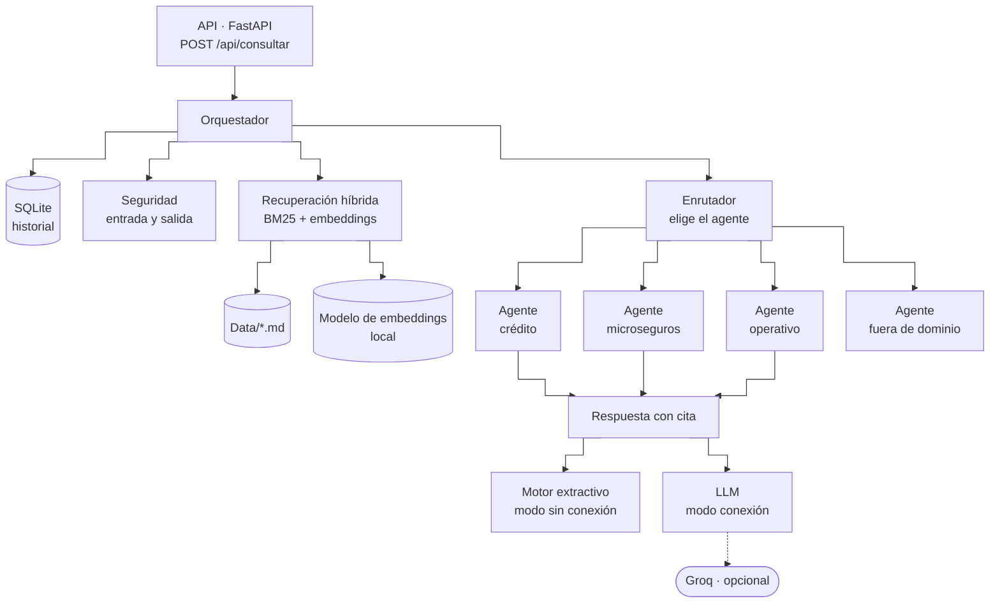
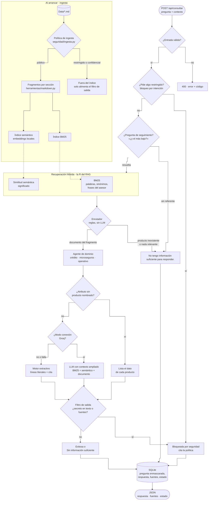

# Plan 001 — Consulta documental con citación de fuentes

## Arquitectura propuesta

Recorrido de una consulta:

Flujo de una consulta: **validar → guardrail de entrada → recuperar (BM25 + embeddings) → responder → guardrail de salida → persistir**. El orquestador es independiente de HTTP para permitir pruebas unitarias sin levantar el servidor. Es un RAG: la recuperación híbrida trae la evidencia y la generación (extractiva o con LLM) responde solo con ella.

> El orquestador y los agentes por dominio se detallan en `especificaciones/004-orquestador-agentes/plan.md`; la recuperación semántica, en `especificaciones/007-recuperacion-semantica/plan.md`.

## Componentes
| Componente | Responsabilidad | Decisiones clave |
|------------|-----------------|------------------|
| `config.py` | Configuración inmutable desde variables de entorno | Valores por defecto seguros: sin LLM, `Data/`, SQLite en `storage/` |
| `herramientas/texto.py` | Normalización en español: tildes, stopwords, raíces, sinónimos | Stemmer propio determinista (sin NLTK/spaCy) aplicado igual a documentos y preguntas |
| `herramientas/corpus.py` + `markdown.py` | Carga y deduplicación (`corpus.py`, con la política de `seguridad/ingesta.py` inyectada); fragmentación por encabezados (`markdown.py`) | Tablas → `clave: valor`; etiqueta + lista → una línea; fragmento «Índice» por documento |
| `herramientas/semantica.py` | Embeddings locales: una entrada por línea, similitud coseno | `fastembed` con un modelo multilingüe en CPU; opcional (`EMBEDDINGS=local`), sin red tras la primera descarga |
| `herramientas/recuperacion.py` | BM25 propio + bloqueo por entidad + priorización del índice | Cobertura calculada sobre términos que existen en el corpus |
| `generacion/extractivo.py` | Respuesta extractiva: elige las líneas que responden; compone texto con cita | Reglas explícitas y probadas (ver «Reglas de selección de líneas») |
| `generacion/llm.py` | Proveedor Groq opcional | Prompt cerrado a fragmentos; temperatura 0; fallback al extractivo |
| `generacion/plantillas.py` + `generacion/prompts/*.j2` | Prompts del LLM como plantillas Jinja2 | Sin autoescape (texto plano), `StrictUndefined` |
| `infraestructura/persistencia.py` | SQLite vía `sqlite3` estándar | Tabla `consultas` con `CHECK` de estado, índices por fecha y estado |
| `api/app.py`, `rutas.py`, `esquemas.py` + `main.py` | API: composición, rutas, modelos de entrada/salida, CORS, errores, request-id | Fábrica `crear_app()` para pruebas; `main.py` es el punto de entrada |
| `infraestructura/observabilidad.py` | Logs JSON | Un evento por consulta con estado/modo/latencia |

### Reglas de selección de líneas
`seleccionar_lineas` decide qué líneas de un fragmento responden. Las raíces de lo que la pregunta nombra (productos, secciones) se separan de los *atributos* pedidos, y se aplica en orden:

0. Una pregunta frecuente cuyo título completo está en la pregunta se devuelve entera (y va primero).
1. Si la pregunta nombra la subsección del fragmento («requisitos», «garantías»), toda la subsección es la respuesta.
2. Si solo nombra la entidad («¿Qué es Vida Protegida?»), se devuelve el fragmento completo; si además pide algo que no existe en la base, no se responde con la descripción del producto.
3. Si el fragmento menciona los atributos pedidos (todos, o al menos dos en preguntas con varios), se devuelven las líneas que más atributos contienen.
4. Si solo coincide parte de lo pedido, responde únicamente una subsección corta (≤ 3 líneas) de un producto nombrado, entera, o una subsección del mismo producto que completa otra que ya respondió.
5. Si no, el fragmento no responde: así no se contesta con datos que no están en el documento.

## Decisiones de arquitectura (ADR resumidos)
- **ADR-1 Recuperación híbrida: BM25 como base, embeddings locales como complemento.** El corpus es pequeño, en español y con vocabulario controlado: BM25 con sinónimos es determinista, explicable y responde bien lo que usa las palabras de los documentos. No alcanza para paráfrasis («¿qué riesgos cubre el seguro para negocios?»), así que se suma un índice semántico local (`fastembed`, ONNX en CPU, sin servicios pagos). Medido con 40 preguntas nuevas: la similitud mejora mucho el contexto del LLM, pero usada para elegir la línea en el modo extractivo aumentaba las respuestas equivocadas; por eso en ese modo solo enruta (ADR-25, especificación 007).
- **ADR-2 Respuesta extractiva por defecto.** Garantiza por construcción "responder únicamente con información encontrada"; un LLM es opcional para redacción.
- **ADR-3 SQLite.** Cero configuración, archivo local, suficiente para el volumen de la prueba; el repositorio aísla el cambio futuro a PostgreSQL.
- **ADR-4 Sin frameworks adicionales** (ORM, rank_bm25, NLTK): menos superficie de ataque y de dependencia; el código propio está cubierto por pruebas.
- **ADR-5 Límite de 1000 caracteres por pregunta** (configurable): protege latencia y costo del LLM y cubre preguntas reales de un asesor.
- **ADR-6 Prompts en plantillas Jinja2** (`src/backend/asistente/generacion/prompts/*.j2`): separa el texto de los prompts del código, permite revisarlos y versionarlos sin tocar Python y deja explícitas sus variables. Jinja2 es una dependencia madura, pura en Python y sin red; se usa sin autoescape (los prompts no son HTML) y con `StrictUndefined` para que una variable faltante falle en lugar de producir un prompt incompleto. Los valores insertados no se reinterpretan como plantilla.
- **ADR-11 Groq como LLM gratuito por defecto** (cuando se activa uno): el enunciado no admite herramientas pagas; GroqCloud ofrece plan gratuito y API compatible con OpenAI (un `httpx.post`, sin SDK nuevo). Modelo por defecto `openai/gpt-oss-20b` (producción vigente; los Llama 3.x se retiraron del plan gratuito el 16/08/2026), `include_reasoning: false`, `reasoning_effort: low`, temperatura 0. Sigue siendo opcional: `LLM_PROVIDER=none` por defecto.
- **ADR-12 Término distintivo en el respaldo (RF-12):** la coincidencia léxica podía caer a un fragmento de otro tema que comparte palabras comunes («válido» ≈ «Validación documental») cuando el fragmento principal («Gestión de PQR») no respondía. Se exige que ese respaldo mencione al menos un término del encabezado del fragmento principal. Una primera versión que exigía términos de *todos* los encabezados recuperados rompía 17 respuestas correctas (preguntas frecuentes generales que no repiten el nombre del producto); se detectó en revisión adversarial y se descartó. Evaluación con un banco de trabajo de 316 preguntas (el versionado tiene 293): la versión final solo cambia las 2 respuestas incorrectas de la PQR.
- **ADR-20 Mejoras del motor medidas, no supuestas (RF-14..RF-16, RF-O9).** Cada regla nueva se validó contra el conjunto de evaluación (97 preguntas con respuesta esperada: 48,5 % → 83,5 % → 100 %) y contra el banco de 293 preguntas, revisando a mano cada respuesta que cambió (87): se descartaron dos sinónimos («plata» → monto, «codeudor» → garantía) y una versión de la regla de ambigüedad porque producían respuestas de otro producto. Ante la duda se prefiere «Sin información» a un dato de otro producto. En la segunda pasada (RF-22) se probaron y descartaron una regla general de participios («utilizada» → «utilizar»), que movía otras respuestas, y un sinónimo global «codeudor» → garantía, que volvía a responder con el Crédito Educativo; se reemplazaron por reglas acotadas y cada una de las 35 respuestas que cambiaron en el banco se revisó a mano.
- **ADR-21 Herramientas de calidad solo de desarrollo.** `ruff` (lint: errores, imports, bugbear, sintaxis moderna) y `mypy` (tipos) se agregan a `requirements-dev.txt` y al CI; no son dependencias de ejecución. No se impone `ruff format` para no reformatear 41 archivos sin cambio funcional. mypy encontró dos defectos reales al activarse: una variable reutilizada con otro tipo en `catalogo.py` y un parámetro sombreado en `extractivo.py`. La cobertura (`pytest-cov`) se reporta en el CI (99 %).
- **ADR-22 Robustez del servicio (RF-17..RF-19).** El `request_id` viaja en un `ContextVar` y una fábrica de registros lo agrega a todo log de la solicitud, sin pasarlo por parámetro entre capas. La configuración se valida al construirse (`__post_init__`): un `TOP_K=0` debe impedir el arranque, no fallar en la primera consulta.

## Estrategia de pruebas
| Nivel | Archivo | Cubre |
|-------|---------|-------|
| Unitarias de texto/corpus | `tests/backend/test_corpus.py` | normalización, stemming, tablas/etiquetas/listas, índice, exclusión de restringidos, duplicados, base vacía |
| Unitarias de recuperación/motor | `tests/backend/test_motor.py` | ranking, bloqueo por entidad, respuestas esperadas, frase canónica, comparación de productos |
| Plantillas de prompts | `tests/backend/test_prompts.py` | carpeta `prompts/`, frase canónica, formato de fragmentos, variable faltante |
| Orquestador (flujo completo) | `tests/backend/test_orquestador.py` | estados, persistencia, caracteres especiales, consulta extensa, duplicados, LLM falso y fallback |
| Contrato HTTP | `tests/backend/test_api.py` | códigos, cuerpos de error, historial, estadísticas, salud |
| Robustez del servicio | `tests/backend/test_robustez_api.py` | `x-request-id` validado y en logs/500, ids no ASCII, `limite` inválido, configuración fuera de rango, citas del bloqueo (RF-17..RF-19, RF-21) |
| Regresión | `tests/backend/test_banco.py` | 293 preguntas reales contra una foto de estado, fuentes y texto; determinismo; latencia p95 (RNF-02) |
| Calidad medida | `tests/backend/test_evaluacion.py` | 97 preguntas con respuesta esperada; la precisión mínima solo puede subir |

Ejecución: `python -m pytest` desde la raíz (sin red, ≈ 1 s). El CI la corre en cada push junto con ruff, mypy y la cobertura. Ciclo TDD: escribir el escenario Gherkin → prueba roja → implementar → verde → refactorizar.

## Trazabilidad
| RF | Pruebas |
|----|---------|
| RF-01 | `test_api.py::test_consulta_valida` |
| RF-02 | `test_corpus.py::test_fragmentar_convierte_tablas_etiquetas_y_listas`, `test_fragmentar_crea_indice_del_documento` |
| RF-03 | `test_motor.py::test_responde_con_la_linea_correcta_y_cita_la_fuente` |
| RF-04 | `test_motor.py::test_bm25_bloqueo_por_entidad_restringe_a_los_fragmentos_del_producto`, `test_no_responde_con_datos_de_otro_producto` |
| RF-05 | `test_motor.py::test_sin_evidencia_responde_la_frase_canonica`, `test_api.py::test_consulta_sin_informacion` |
| RF-06 | `test_guardrails.py` (validación), `test_api.py::test_pregunta_vacia/test_cuerpo_invalido/test_pregunta_demasiado_larga/test_caracteres_especiales` |
| RF-07 | `test_corpus.py::test_documentos_duplicados_se_indexan_una_sola_vez`, `test_orquestador.py::test_documentos_duplicados_no_duplican_fuentes` |
| RF-08 | `test_corpus.py::test_base_documental_vacia_o_inexistente`, `test_orquestador.py::test_base_documental_vacia` |
| RF-09 | `test_orquestador.py::test_consulta_valida_es_exitosa_y_queda_registrada`, `test_repositorio_guarda_lista_y_calcula_estadisticas` |
| RF-10 | `test_api.py::test_historial_y_estadisticas`, `test_salud` |
| RF-11 | `test_orquestador.py::test_llm_*`, `test_prompts.py`, `test_proveedores_llm.py` |
| RF-12 | `test_motor.py::test_parafrasis_no_responde_con_datos_de_otro_tema`, `test_rf12_no_descarta_respuestas_generales` |
| RF-03, RF-05 (corrección medida) | `test_evaluacion.py` (97 casos con respuesta esperada, precisión mínima), `test_banco.py` (293 preguntas: estado, fuentes y texto) |
| RF-14..RF-16, RF-22 | `test_evaluacion.py` (precisión 100 %, 97/97), `test_motor.py::test_frases_del_asesor_llegan_al_termino_del_documento`, `test_pregunta_frecuente_contenida_completa_responde_primero`, `test_titulo_de_pregunta_frecuente_no_se_nombra_a_medias`, `test_subseccion_corta_del_producto_nombrado_responde_entera`, `test_banco.py`, `test_motor.py`, `test_corpus.py::test_tokenizar_elimina_stopwords_y_aplica_sinonimos` |
| RF-13 | `test_motor.py::test_producto_o_atributo_inexistente_no_responde_con_otro`, `test_palabras_desconocidas_que_no_nombran_producto_siguen_respondiendo` |
| RF-17 | `test_robustez_api.py::test_id_de_solicitud_valido_se_respeta`, `test_id_de_solicitud_invalido_se_reemplaza`, `test_el_id_de_solicitud_llega_a_los_logs_de_la_consulta`, `test_el_error_interno_conserva_el_id_de_solicitud` |
| RF-18 | `test_robustez_api.py::test_id_de_consulta_con_digitos_no_ascii_es_400`, `test_limite_de_historial_invalido_explica_el_parametro` |
| RF-19 | `test_robustez_api.py::test_configuracion_invalida_se_rechaza`, `test_variable_de_entorno_invalida_nombra_la_variable`, `test_nivel_de_log_es_parte_de_la_configuracion` |
| RF-20 | `test_corpus.py::test_bom_no_convierte_el_titulo_en_texto`, `test_tabla_de_tres_columnas_conserva_la_cabecera`, `test_etiqueta_con_horas_se_une_a_su_valor`, `test_comparadores_no_se_borran_como_html` |
| RF-21 | `test_robustez_api.py::test_respuesta_bloqueada_cita_solo_secciones_que_existen`, `test_respuesta_bloqueada_sin_las_politicas_en_el_corpus_no_inventa_fuentes`, `test_openapi_documenta_pregunta_como_texto_obligatorio` |
| RNF-01 | `test_proveedores_llm.py::test_por_defecto_no_hay_proveedor`; el CI corre sin red ni secretos |
| RNF-02 | `test_banco.py::test_latencia_p95_del_modo_extractivo` (medido: p95 ≈ 1 ms) |
| RNF-03 | `test_banco.py::test_el_banco_es_determinista` |
| RNF-04 | la suite completa tarda ≈ 1 s localmente y en el CI |
| RNF-05 | `test_api.py` y `test_guardrails.py` verifican los mensajes de error en español |
| RNF-06 | `test_robustez_api.py::test_el_formateador_incluye_el_id_de_solicitud`, `test_los_logs_de_uvicorn_salen_en_el_mismo_formato_json`; `test_agentes.py::test_log_incluye_agente_y_motivo` |
